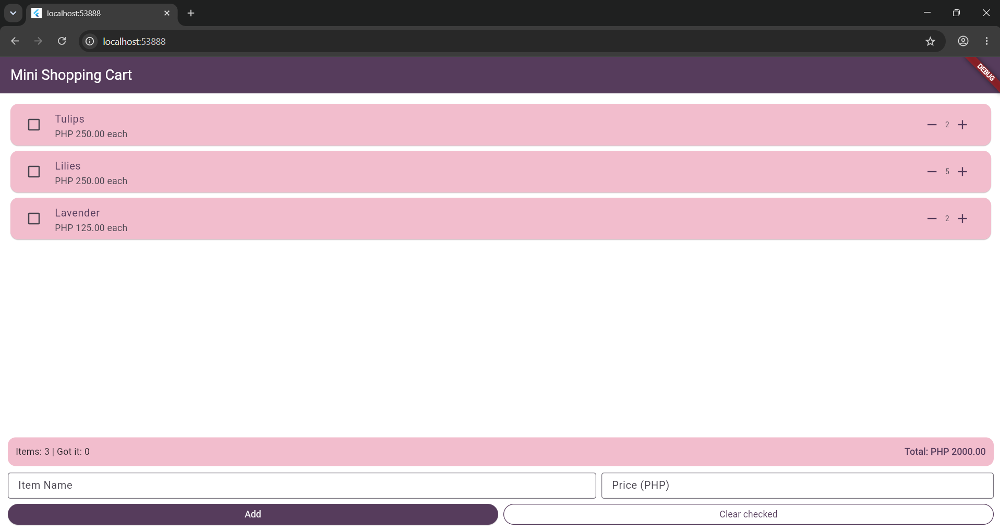

# Mini Shopping Cart

**Name:** Yaohan M. Macoto  
**Activity:** Laboratory Activity No. 3  
**Project:** Building a Mini Shopping Cart with StatefulWidget

## Description

This Flutter application allows users to manage a mini shopping cart containing items, prices, and quantities. It uses `StatefulWidget` and `setState()` to update the user interface whenever users change item quantities, mark items as collected, add new items, or clear checked items.

The application also includes input validation, a live total price calculation, and `initState()` and `dispose()` to manage the initial sample items and text controllers.

## Screenshot

